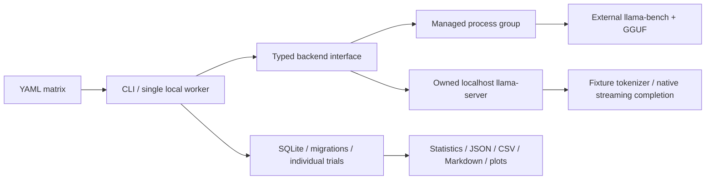
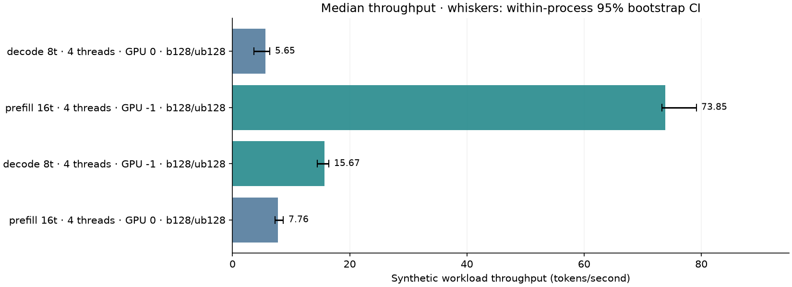

# LLM Inference Optimization Lab (LIOL)

Measure local LLM inference with traceable experiments, upstream llama.cpp timings, and explicit
statistical limits. LIOL covers the path from workload design
to process management, measurement validation, persistence, and performance investigation.

**v0.2.0** provides a Python CLI for CPU/Metal synthetic benchmarks and warm text requests.
It runs external GGUF weights, stores every measured repetition in SQLite, exports CSV/JSON,
and generates tables and scientific plots. Published measurements include a CPU/Metal check
and a negative microbatch tuning experiment. The managed-server backend adds actual model
tokenization, streaming TTFT and request latency. Concurrent workloads, a FastAPI service and
a React dashboard are on the roadmap.

## Architecture



The backend probes the installed binary's help and devices, rejects incompatible settings,
controls CPU/Metal placement, captures raw logs, and validates observed parameters and token
counts. Model loading is excluded from the upstream inference timings. A per-user lock prevents
simultaneous LIOL workers. Ctrl-C and timeouts shut down owned processes and preserve failure states.

## Setup

Requirements: Python 3.12+, [uv](https://docs.astral.sh/uv/), a compatible recent `llama-bench`
and/or `llama-server`,
and an existing GGUF. Verified on macOS arm64 with an M2 Pro (32 GiB) and llama.cpp b12182.
Linux CPU support is designed into the POSIX implementation but has not been exercised on a
Linux machine. Windows is unsupported. Metal requires an Apple GPU exposed to the process.
CMake is only needed if you choose to build llama.cpp yourself.

```sh
cd llm-inference-lab
make install
cp .env.example .env
# Edit .env with your GGUF and engine paths, quoting paths with spaces.
set -a
source .env
set +a
make doctor
make smoke-test     # isolated test engine; no weights needed
make smoke          # real GGUF, Metal, two workloads, five repetitions each
make server-smoke   # real text fixture, one full warmup, five streaming requests
```

Engine and model paths are supplied through configuration; LIOL does not download or modify
them. `uv.lock` pins Python dependencies. The reference benchmark environment is documented in
[environment.md](docs/environment.md). Keep `.env`, local databases, model
weights and raw result directories out of Git; ignore rules are included.

Choose a GGUF supported by your installed engine, leave room for KV/compute buffers and other
applications, and verify its applicable license and exact source revision before redistribution.
The existing Gemma 12B Q3_K_M fits the inspected machine and passed actual execution. Its file
hash is recorded, but its original source revision and license are not independently verified.
Do not use filename alone to infer architecture, quantization or model equivalence.

## Run and reproduce experiments

```sh
uv run liol plan configs/quick-baseline.yaml   # inspect randomized matrix without inference
uv run liol run configs/quick-baseline.yaml    # small CPU versus Metal verification
uv run liol run configs/tuning.yaml            # 512-token Metal microbatch sweep
make baseline                                # longer 128/512/1024 and 64/128/256 suite
uv run liol run configs/hardware.yaml          # CPU thread-count sensitivity
uv run liol doctor --engine server --binary "$LIOL_LLAMA_SERVER"
uv run liol plan configs/server-smoke.yaml
uv run liol run configs/server-verification.yaml # 128/512/1024-token text prefixes
make server-baseline                         # longer text-request length matrix
uv run liol list
uv run liol show EXPERIMENT_ID
uv run liol export EXPERIMENT_ID --format csv --output data/results/export.csv
uv run liol export EXPERIMENT_ID --format json --output data/results/export.json
make report ID=EXPERIMENT_ID
```

Use `uv run liol --db /path/to/results.sqlite3 ...` or `LIOL_DB` for another database.
Successful and failed runs automatically export into `data/results/EXPERIMENT_ID/`.
Exit codes: 0 completed, 1 experiment failure, 2 validation/storage/preflight error, 130 canceled.
Configuration paths are relative to the YAML file; environment-expanded absolute paths are
recommended. Unknown keys, duplicate YAML keys, invalid dimensions and oversized matrices fail.
`repetitions` defaults to five. Logical batch must be at least microbatch size. No free-form
shell arguments or remote execution interface exists.

Both modes vary workload length, threads, offload, logical batch and microbatch. `request_warm`
also specifies fixture files, fixed context size, complete warmup requests, a sampling seed and
EOS policy. The fixture is tokenized with the actual loaded model; exactly the first requested
number of token IDs is supplied to completion. Insufficient fixture length is a validation failure.
Prefix caching is explicitly disabled. See [request benchmarks](docs/request-benchmarks.md).
Use separate model paths/configurations for quantizations of the **same underlying model revision**.
`configs/quantization.yaml` is a single-model template, not a prevalidated multi-model comparison.
For a CPU-only machine, use `gpu_layers: [0]`; Metal is `[-1]` (all layers requested) or a positive
layer count. GPU execution is validated through discovered devices, reported control fields and
retained verbose offload logs. CPU placement also disables KV and operation offload.

## Measurement boundaries

| Measurement | Source and units |
|---|---|
| Prefill/decode throughput | Upstream individual `samples_ns`; tokens/second |
| Workload duration | Upstream nanoseconds, exported also as milliseconds |
| Process wall time | Supervisor clock; includes startup/load/warmup, separate from inference |
| Sampled peak RSS | Maximum observed root-process RSS at 20 ms intervals; bytes |
| Sampled CPU time | Last observed root-process user + system CPU seconds |
| TTFT / request / inter-token latency | Unavailable in synthetic mode |
| Request-mode TTFT | Dispatch to first received generated-token event; milliseconds |
| Request-mode latency | Dispatch to terminal completion event; milliseconds |
| Request-mode prefill/decode | Native server timing fields; tokens/second |
| Request-mode token intervals | Receive-event intervals, available only with complete individual token coverage |
| GPU VRAM / utilization / power / thermal pressure | Unavailable |

`llama-bench` uses synthetic vocabulary IDs, **not natural-text fixtures**. Prefill and decode
are separate workloads; decode starts with no populated prompt context. Counts are validated
against engine output. Native warmup stays enabled and KV memory is cleared between measured
repetitions. There is no prefix reuse or sampled EOS stopping in this mode.

`request_warm` keeps the model loaded across full warmup and measured requests. Model startup,
tokenization and warmup are outside request timers. Native completion uses fixture token IDs
directly, with explicit greedy sampling and cache settings. Response headers, metadata and empty
events do not stop the TTFT clock. Incomplete Unicode coverage or transport coalescing makes
token-interval metrics unavailable. Actual output length and early stopping are recorded.
These measurements describe raw text completion, with no chat template or answer-quality claim.

Each result retains model SHA-256, GGUF metadata, engine version/binary hash/help/devices,
environment, exact argv, raw stdout/stderr, case order and individual trials. Reports show
mean, median, sample SD and bootstrap median intervals at n>=5. p95 requires n>=20. Repetitions
within one process can be correlated; the intervals omit between-session drift. Process RSS
on unified-memory Macs must never be called measured GPU VRAM.

See [methodology](docs/methodology.md), [architecture](docs/architecture.md), and
[limitations](docs/limitations.md) for exact definitions and outstanding work.

## Reference measurements

M2 Pro, 32 GiB, macOS 27.0.1, llama.cpp b12182, Gemma-4-12B Q3_K_M; five repetitions per
case, four CPU threads, batch/microbatch 128, native warmup. Battery power was observed.

| Synthetic workload | CPU median tok/s | Metal median tok/s |
|---|---:|---:|
| Prefill 16 tokens | 7.76 | 73.85 |
| Decode 8 tokens, empty initial context | 5.65 | 15.67 |



These small verification cases establish a reference for this environment. They do not cover
the full baseline matrix or support a general hardware claim.
See the [measured table](reports/quick-baseline.md), [compact individual samples](reports/quick-baseline.json),
and [technical report](reports/technical-report.md). All published samples come from actual local runs.
Model-free smoke tests use isolated fixtures under `tests/`.

Warm native-completion verification used the same model, six threads, context 2048,
batch/microbatch 512/128, one full warmup and five measured requests per case. Every request
generated exactly 16 tokens and reported zero prefix-cache reuse. Battery power was observed.

| Prompt tokens | Median TTFT, ms | Median request latency, ms | Native decode, tokens/s |
|---|---:|---:|---:|
| 128 | 1244.79 | 2466.01 | 12.28 |
| 512 | 4110.64 | 5381.76 | 11.80 |
| 1024 | 8270.24 | 9622.05 | 11.35 |

See the [request study](reports/request-study.md), [individual request records](reports/warm-requests.json)
and [full statistics](reports/warm-requests.md). These are separate from synthetic results.

## Optimization investigation

The initial hypothesis was that increasing Metal microbatch size would improve prefill throughput.
At 512 prompt tokens, six threads and logical batch 512, microbatch 128 measured **133.10 tok/s**
median; microbatch 512 measured **121.81 tok/s**. The proposed increase did not improve this run.
This parameter-tuning experiment documents workload-size controls, within-process uncertainty,
battery/thermal confounders, and the need for independent validation. It does not demonstrate
an original kernel or code optimization.
See [optimization notes](docs/optimizations.md) and [the technical report](reports/technical-report.md).

## Development

```sh
make check       # Ruff lint/format, strict mypy, pytest
make test
make smoke-test  # CLI, persistence, exports, cancellation; no model required
uv build --wheel
```

Tests cover configuration, units, statistics, raw-output validation, process lifecycle,
SQLite/migrations, failures, missing models, cancellation, exports, reports and CLI integration.
The package wheel was separately installed in a temporary environment and its migration verified.
Charts are Matplotlib SVG/PNG with within-process bootstrap intervals.

The next work is independent interleaved trials, FastAPI and a live-data React dashboard,
full baseline suites, then profiling-driven original code
optimization. See the [development guide](docs/development.md) for validation and release scope,
and [contribution ideas](docs/contributing-ideas.md) for research directions.

Code license: MIT. Engine and model licenses remain separate.
