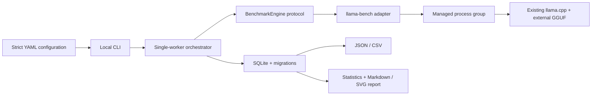

# Architecture

The orchestration layer accepts a typed engine protocol (`probe`, `run`, `parse`). The engine
adapter owns version checks and subprocess arguments; no shell string or user-supplied flags
are executed. The current request type is a synthetic workload case. A future server backend
should introduce an explicit natural-text workload type to preserve the distinction in semantics.

`schemas/config.py` validates paths, environment expansion, bounded matrix size and explicit
settings. `benchmarks/model.py` reads GGUF metadata and hashes the file without changing it.
`engines/process.py` owns child lifecycle and root-process resource sampling. `benchmarks/runner.py`
orders cases and records all terminal outcomes. Storage serializes configuration and raw provenance
as JSON alongside normalized per-repetition samples for queries. Reports are generated from
stored measurements.

The CLI runs on macOS and Linux (POSIX process groups and flock); Metal is Apple-specific.
CPU mode can run on Linux with a compatible recent binary exposing the required controls.
Linux execution is unit-covered only where platform-independent; no Linux machine was tested.
Windows support is not implemented. The v0.1.0 CLI has no network listener or remote execution API.

The planned FastAPI service will submit validated configurations to the serialized worker,
bind to localhost, and query storage. The React client will render stored samples and warn
on incompatible comparisons. These components are outside the v0.1.0 release scope.
