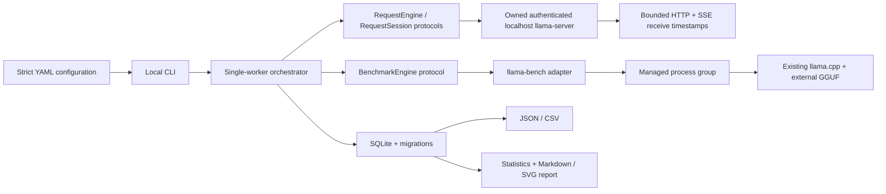

# Architecture

The synthetic orchestration layer accepts a typed engine protocol (`probe`, `run`, `parse`). The engine
adapter owns version checks and subprocess arguments; no shell string or user-supplied flags
are executed. Warm text requests use a separate RequestConfig, RequestEngine and RequestSession
contract. Each owned server session tokenizes a fixture, accepts exact token-ID prefixes and
performs full warmup and measured requests. This preserves the distinction between synthetic
workload time, native engine throughput and client-observed streaming latency.

`schemas/config.py` validates paths, environment expansion, bounded matrix size and explicit
settings. `benchmarks/model.py` reads GGUF metadata and hashes the file without changing it.
`engines/process.py` owns child lifecycle and root-process resource sampling. `benchmarks/runner.py`
orders cases and records all terminal outcomes. Storage serializes configuration and raw provenance
as JSON alongside normalized per-repetition samples for queries. Reports are generated from
stored measurements.

`request_runner.py` owns request ordering, model/fixture provenance and per-case session cleanup.
`llama_server.py` manages authenticated loopback-only server startup and resource sampling.
`http_stream.py` enforces overall deadlines and cancellation while decoding bounded SSE frames.
Token timestamps use receive batches rather than assigning artificial independent times to
multiple records from one read. SQLite migration 002 adds request samples alongside synthetic
samples; request reports and CSV exports preserve their distinct definitions.

The CLI runs on macOS and Linux (POSIX process groups and flock); Metal is Apple-specific.
CPU mode can run on Linux with a compatible recent binary exposing the required controls.
Linux execution is unit-covered only where platform-independent; no Linux machine was tested.
Windows support is not implemented. Request mode owns an ephemeral loopback listener with a
random temporary API key and no web UI. The CLI exposes no remote benchmark execution API.

The planned FastAPI service will submit validated configurations to the serialized worker,
bind to localhost, and query storage. The React client will render stored samples and warn
on incompatible comparisons. These components remain on the roadmap.
