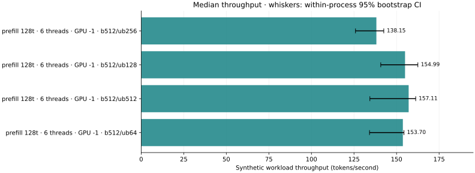

# metal-microbatch-tuning

Experiment: `955d6ab2-0316-49a4-98c5-d65f0241d34a`
Status: **completed**

Synthetic prefill/decode microbenchmark; no request latency or TTFT is measured.

| Workload | Tokens | Threads | GPU layers | Batch / microbatch | n | Median tok/s | Mean | SD | Median 95% bootstrap CI |
|---|---:|---:|---:|---:|---:|---:|---:|---:|---|
| prefill | 128 | 6 | -1 | 512 / 256 | 5 | 138.15 | 135.63 | 6.51 | [125.88, 142.50] |
| prefill | 128 | 6 | -1 | 512 / 128 | 5 | 154.99 | 152.18 | 10.34 | [140.72, 162.52] |
| prefill | 128 | 6 | -1 | 512 / 512 | 5 | 157.11 | 152.51 | 11.23 | [134.33, 161.24] |
| prefill | 128 | 6 | -1 | 512 / 64 | 5 | 153.70 | 146.64 | 10.18 | [134.13, 154.36] |

Confidence intervals resample within one process, not independent machine sessions.
p95 requires at least 20 repetitions. Small samples cannot describe tails.

Process RSS includes mapped host memory; it is not measured GPU VRAM.

Full raw exports retain commands, timings, model hash, stderr and environment.

