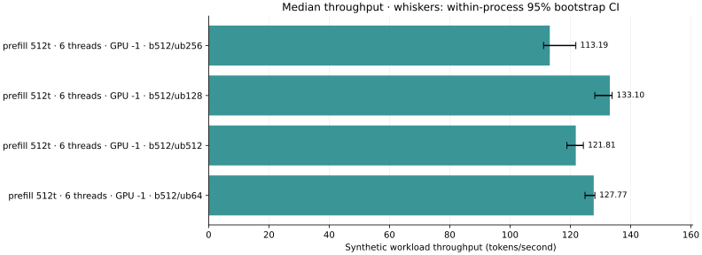

# metal-microbatch-tuning

Experiment: `949a6133-0b05-497f-ade2-f20a89822cc8`
Status: **completed**

Synthetic prefill/decode microbenchmark; no request latency or TTFT is measured.

| Workload | Tokens | Threads | GPU layers | Batch / microbatch | n | Median tok/s | Mean | SD | Median 95% bootstrap CI |
|---|---:|---:|---:|---:|---:|---:|---:|---:|---|
| prefill | 512 | 6 | -1 | 512 / 256 | 5 | 113.19 | 114.93 | 4.22 | [111.12, 121.83] |
| prefill | 512 | 6 | -1 | 512 / 128 | 5 | 133.10 | 131.49 | 2.83 | [128.13, 133.87] |
| prefill | 512 | 6 | -1 | 512 / 512 | 5 | 121.81 | 121.80 | 2.00 | [118.87, 124.33] |
| prefill | 512 | 6 | -1 | 512 / 64 | 5 | 127.77 | 127.15 | 1.34 | [124.87, 128.15] |

Confidence intervals resample within one process, not independent machine sessions.
p95 requires at least 20 repetitions. Small samples cannot describe tails.

Process RSS includes mapped host memory; it is not measured GPU VRAM.

Full raw exports retain commands, timings, model hash, stderr and environment.

