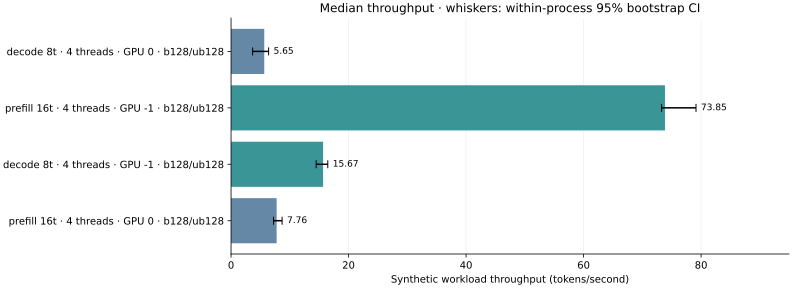

# quick-cpu-metal-check

Experiment: `c2b2d529-5cb1-4089-a42c-683f7d1ecebd`
Status: **completed**

Synthetic prefill/decode microbenchmark; no request latency or TTFT is measured.

| Workload | Tokens | Threads | GPU layers | Batch / microbatch | n | Median tok/s | Mean | SD | Median 95% bootstrap CI |
|---|---:|---:|---:|---:|---:|---:|---:|---:|---|
| decode | 8 | 4 | 0 | 128 / 128 | 5 | 5.65 | 5.31 | 1.09 | [3.67, 6.39] |
| prefill | 16 | 4 | -1 | 128 / 128 | 5 | 73.85 | 75.34 | 2.64 | [73.27, 79.13] |
| decode | 8 | 4 | -1 | 128 / 128 | 5 | 15.67 | 15.67 | 0.74 | [14.49, 16.47] |
| prefill | 16 | 4 | 0 | 128 / 128 | 5 | 7.76 | 7.76 | 0.58 | [7.22, 8.69] |

Confidence intervals resample within one process, not independent machine sessions.
p95 requires at least 20 repetitions. Small samples cannot describe tails.

Process RSS includes mapped host memory; it is not measured GPU VRAM.

Full raw exports retain commands, timings, model hash, stderr and environment.

