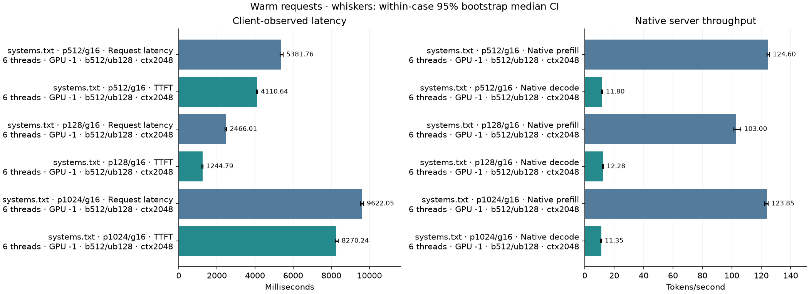

# Tokenizer-validated warm request verification

The managed-server backend was validated with real native text completions at 128, 512 and
1024 prompt tokens. Each case performed one full unmeasured warmup and five measured requests.
This checks model tokenization, streaming timing, cache isolation, persistence and cleanup.
It is not an optimization or answer-quality comparison.

## Environment and workload

Apple M2 Pro, 10 CPU cores (6 performance), 16 GPU cores, 32 GiB unified memory, macOS 27.0.1,
Python 3.13.14 and llama.cpp b12182 (`fd27b2034905f8dadd8bd6d2cc44595f4929d391`).
The existing Gemma-4-12B Q3_K_M file was reused with SHA-256
`dbf58f4c413b82b27106867eb42f7087e4172a172f6f201e2e11598a6582e504`.
Battery power was recorded. Thermal pressure and watts were unavailable.

The configuration is [server-verification.yaml](../configs/server-verification.yaml): six threads,
Metal offload, logical batch 512, microbatch 128, fixed context 2048, greedy temperature-zero
sampling with seed 42, and `ignore_eos=true` to hold generation work at 16 tokens. This is native
completion without a chat template. The model's original source revision/license remain unverified.

The actual tokenizer returned **1169 tokens**, including its special-token policy, for
[systems.txt](../data/prompts/systems.txt). The fixture SHA-256 is
`0a160e1bfd21eaa482176a6b5304bb99d290767cc6081f5f9646bcee594647a1`.
Each request supplied exactly the selected prefix of token IDs. Source text, special-token
settings, input IDs, output counts and raw terminal responses are retained in the evidence.

## Results

Experiment `353291a8-9981-4072-9946-b0d18dd1a3f7`, five measured requests per case:

| Prompt tokens | Median TTFT, ms | TTFT median 95% CI | Median request latency, ms | Native prefill, tokens/s | Native decode, tokens/s |
|---|---:|---|---:|---:|---:|
| 128 | 1244.79 | [1207.36, 1264.96] | 2466.01 | 103.00 | 12.28 |
| 512 | 4110.64 | [4074.76, 4135.64] | 5381.76 | 124.60 | 11.80 |
| 1024 | 8270.24 | [8212.98, 8372.58] | 9622.05 | 123.85 | 11.35 |

All 15 requests generated exactly 16 tokens, reported `timings.cache_n=0`, and completed without
context truncation. The observed stream covered individual tokens in these samples, permitting
client-observed token intervals. Median per-request mean intervals were 81.39, 84.72 and 88.06 ms
for the three prompt lengths. General inputs can have incomplete Unicode coverage or coalesced
arrivals, in which case these interval metrics are explicitly unavailable.



Server startup took approximately 1.20–1.24 seconds per case and was measured separately from
requests. These startup observations can include warm filesystem cache and are not a cold-load
study. TTFT starts at dispatch and stops at receipt of the first generated-token event, excluding
response headers and null/progress events. Request latency stops at the terminal completion event.
Native decode uses the server's `predicted_n-1` timing denominator rather than counting the first
generated token as a separate decode step.

## Interpretation and validation

Longer prompt prefixes increased first-token latency in this run, consistent with the additional
prompt work performed without prefix reuse. The experiment does not isolate a kernel bottleneck
or justify a general hardware speedup. Case order was randomized (512, 128, 1024), with sequential
requests inside each case. Bootstrap intervals use 2000 resamples of each case, seed 42, and
omit between-session variation. Five samples cannot establish tail latency; p95 is unavailable.

The reference run was collected after automated tests finished. An earlier pilot that overlapped
test workloads is labeled as such in local metadata and is not used here. Another interrupted
development run exposed a socket/HTTP-response close race. The implementation now interrupts
only the transport socket from its watchdog and closes HTTP state on the request thread; a
chunked keep-alive regression covers this behavior. A subsequent real cancellation returned
exit 130, preserved the completed request as partial evidence and reaped the owned server.

Reproduce the workload with `uv run liol run configs/server-verification.yaml` after configuring
model and server paths. Regenerate the published table and figure without weights:

```sh
uv run python scripts/render_report.py reports/warm-requests.json data/results/recreated-request.md
```

The [compact records](warm-requests.json) preserve measured values and token evidence with local
paths replaced by filenames. Complete local exports retain full process logs and paths. The
[generated statistics](warm-requests.md) include all latency, throughput and interval aggregates.
See [request methodology](../docs/request-benchmarks.md) for protocol and resource boundaries.
