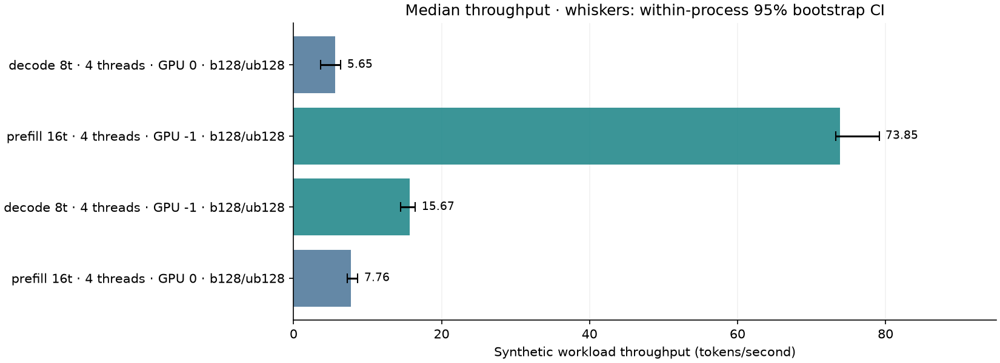
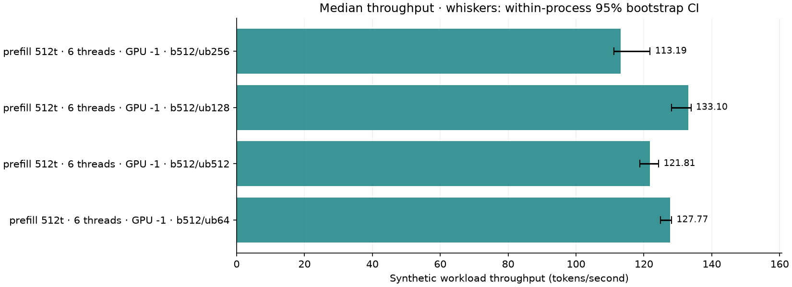

# Measurement platform and microbatch experiment

## Question and hypothesis

Can a local benchmarking platform preserve enough evidence to compare CPU and Metal execution
and assess a configuration optimization without confusing model loading, inference timing and
request latency? The tuning hypothesis was that increasing Metal microbatch size from 128 to
512 would improve prefill throughput by processing fewer chunks per prompt.

## Environment and provenance

The inspected machine is an Apple M2 Pro MacBook Pro: 10 CPU cores (6 performance, 4 efficiency),
16 GPU cores and 32 GiB unified memory, running macOS 27.0.1 arm64. Project Python is 3.13.14.
Existing llama.cpp b12182 reports commit prefix `fd27b2034`; the official release resolves it to
`fd27b2034905f8dadd8bd6d2cc44595f4929d391`. Full original CMake flags are unavailable. The existing
runtime was reused without modification. The benchmark process had local Metal device access.

Weights: Gemma-4-12B-It Q3_K_M, 5,678,047,424 bytes, SHA-256
`dbf58f4c413b82b27106867eb42f7087e4172a172f6f201e2e11598a6582e504`.
The model's original source revision and license were not independently verified; no weights
were downloaded or redistributed. Full local records retain binary hashes, help, devices,
commands, environment, output and stderr. Compact published JSON removes local paths/raw logs.

## Experimental design

The CLI recorded four completed experiments, 14 cases and 70 individual measured repetitions:
the initial two-case Metal smoke, a four-case CPU/Metal check, a four-case 128-token exploratory
sweep and a four-case 512-token follow-up. Each case used one process, upstream native warmup
and five measured repetitions. Cases were shuffled using seed 42. Repetitions were contiguous.

All timings come from upstream `samples_ns`, converted to tokens/second and checked against
reported rates. Prompts and subsequent tokens are synthetic vocabulary IDs. Prefill and decode
are separate workloads; decode starts without a populated prompt context. KV memory is cleared
between repetitions. No request latency, TTFT, answer quality or concurrent throughput is measured.

CPU mode explicitly disables layer/KV/operation offload and selects device `none`. Metal mode
selects discovered `MTL0`, requests all layers, and enables those offload paths. These are the
defined backend conditions; all other settings are held constant within the CPU/Metal check.

## Small verification baseline

Experiment `c2b2d529-5cb1-4089-a42c-683f7d1ecebd`: four threads, batch/microbatch 128,
flash attention `auto`. Battery power was recorded at experiment start.

| Backend / synthetic workload | Median tok/s | Mean | Sample SD | Median 95% bootstrap CI |
|---|---:|---:|---:|---:|
| CPU prefill 16 tokens | 7.76 | 7.76 | 0.58 | [7.22, 8.69] |
| Metal prefill 16 tokens | 73.85 | 75.34 | 2.64 | [73.27, 79.13] |
| CPU decode 8 tokens | 5.65 | 5.31 | 1.09 | [3.67, 6.39] |
| Metal decode 8 tokens | 15.67 | 15.67 | 0.74 | [14.49, 16.47] |



This check validates the engine integration and separate inference/resource timing path. It
does not establish behavior across the full proposed prompt/generation grid. Earlier Metal
smoke decode measured 11.19 tok/s median at the same small length; this variation reinforces
the need for independent sessions and stable conditions. Different experiments are not pooled.

## Bottleneck investigation and proposed improvement

The checks show that backend placement strongly affects these small synthetic workloads.
They do not isolate a kernel bottleneck. The first configuration-level investigation targeted
prefill chunking by changing only microbatch size. The initial 128-token sweep included sizes
larger than the prompt and was unsuitable for comparing all effective batch shapes. That
exploration is preserved rather than discarded. The follow-up increased the prompt to 512,
kept logical batch 512 and six threads, and compared 64/128/256/512 microbatches within that run.

## Tuning results

Experiment `949a6133-0b05-497f-ade2-f20a89822cc8`, with battery power recorded at start:

| Microbatch | Median tok/s | Mean | Sample SD | Median 95% bootstrap CI |
|---|---:|---:|---:|---:|
| 64 | 127.77 | 127.15 | 1.34 | [124.87, 128.15] |
| 128 (starting setting) | 133.10 | 131.49 | 2.83 | [128.13, 133.87] |
| 256 | 113.19 | 114.93 | 4.22 | [111.12, 121.83] |
| 512 (proposed increase) | 121.81 | 121.80 | 2.00 | [118.87, 124.33] |



The proposed increase did not help: median throughput was about 8.5% lower than the starting
setting. This is a descriptive ratio, not an independently validated causal effect or a ratio
confidence interval. The measured result does not justify changing the default or claiming an
original optimization. Larger settings consumed somewhat more sampled root-process RSS
(microbatch 128: 6,076,825,600 bytes; 512: 6,111,526,912 bytes), but the difference does not
measure GPU memory or prove a memory bottleneck. Verbose logs confirmed 49/49 layers offloaded.

## Uncertainty, limitations and follow-up

Intervals use 2,000 percentile-bootstrap resamples of the median, seed 42, within one process.
Five observations produce weak evidence; p95 is intentionally unavailable. Thermal pressure,
watts and GPU utilization were not reliably measurable. Battery operation, untracked background
activity, cache state and contiguous case ordering can confound comparisons. These intervals
do not cover between-session variation or autocorrelation. No quality comparison was conducted.

Next: repeat baseline and candidate in alternating independent sessions on stable AC power;
use supported Metal profiling to separate dispatch and device work; test 128/512/1024-token
natural prompts with actual tokenizer counts; add managed-server TTFT and concurrency. An
original Python/C++ change should follow a specific profiled bottleneck, with a regression test
and controlled before/after timing. The v0.1.0 implementation does not modify upstream llama.cpp.

## Reproduction and evidence

```sh
uv run liol run configs/quick-baseline.yaml
uv run liol run configs/tuning.yaml
uv run python scripts/publish_results.py EXPERIMENT_ID reports/new-run
uv run python scripts/render_report.py reports/microbatch-512.json data/results/recreated.md
```

Set model/engine environment paths first, as shown in the README. Exact individual samples:
[quick check](quick-baseline.json), [128-token exploration](microbatch-128-exploratory.json),
[512-token follow-up](microbatch-512.json). The compact data can regenerate tables and plots
without weights. Local ignored SQLite/raw exports retain full machine-specific provenance.
Automated validation and packaging checks are documented in the
[development guide](../docs/development.md).
