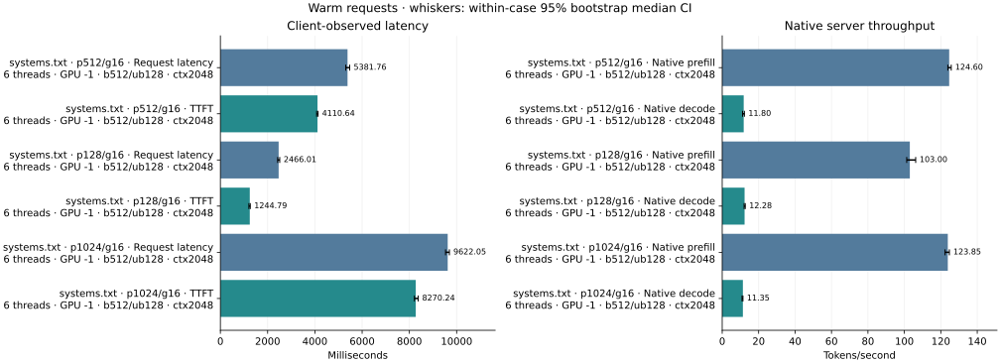

# warm-request-verification

Experiment: `353291a8-9981-4072-9946-b0d18dd1a3f7`
Status: **completed**

Warm single-request measurements; model initialization and warmups are excluded.
TTFT begins at request dispatch and ends at the first generated-token event.

## systems.txt · p512 / g16 · 6 threads · GPU -1 · b512/ub128 · ctx2048

Case: `7f0f47de-2e81-425c-964f-b446c28ab66b`

Measured requests: 5. Observed generated token counts: 16. Early stops: 0.

| Metric | Unit | n | Median | Mean | Sample SD | p95 | Median 95% CI |
|---|---|---:|---:|---:|---:|---:|---|
| Request latency | ms | 5 | 5381.76 | 5381.52 | 60.80 | unavailable | [5306.55, 5472.87] |
| TTFT | ms | 5 | 4110.64 | 4106.40 | 27.70 | unavailable | [4074.76, 4135.64] |
| Native prefill | tokens/s | 5 | 124.60 | 124.75 | 0.84 | unavailable | [123.87, 125.72] |
| Native decode | tokens/s | 5 | 11.80 | 11.78 | 0.37 | unavailable | [11.17, 12.18] |
| Mean observed token interval | ms | 5 | 84.72 | 84.99 | 2.76 | unavailable | [82.11, 89.52] |
| Median observed token interval | ms | 5 | 84.33 | 87.19 | 5.47 | unavailable | [83.64, 96.52] |

## systems.txt · p128 / g16 · 6 threads · GPU -1 · b512/ub128 · ctx2048

Case: `18d7fb33-a9c6-44c4-b40b-c93b6c3b1ab9`

Measured requests: 5. Observed generated token counts: 16. Early stops: 0.

| Metric | Unit | n | Median | Mean | Sample SD | p95 | Median 95% CI |
|---|---|---:|---:|---:|---:|---:|---|
| Request latency | ms | 5 | 2466.01 | 2466.22 | 32.27 | unavailable | [2423.00, 2511.72] |
| TTFT | ms | 5 | 1244.79 | 1243.37 | 23.29 | unavailable | [1207.36, 1264.96] |
| Native prefill | tokens/s | 5 | 103.00 | 103.12 | 1.98 | unavailable | [101.29, 106.20] |
| Native decode | tokens/s | 5 | 12.28 | 12.27 | 0.26 | unavailable | [12.03, 12.65] |
| Mean observed token interval | ms | 5 | 81.39 | 81.50 | 1.71 | unavailable | [79.04, 83.12] |
| Median observed token interval | ms | 5 | 78.82 | 79.78 | 1.99 | unavailable | [78.54, 83.26] |

## systems.txt · p1024 / g16 · 6 threads · GPU -1 · b512/ub128 · ctx2048

Case: `56d89477-c320-4c57-ba5c-7ca4f794b961`

Measured requests: 5. Observed generated token counts: 16. Early stops: 0.

| Metric | Unit | n | Median | Mean | Sample SD | p95 | Median 95% CI |
|---|---|---:|---:|---:|---:|---:|---|
| Request latency | ms | 5 | 9622.05 | 9610.97 | 65.73 | unavailable | [9530.18, 9693.57] |
| TTFT | ms | 5 | 8270.24 | 8278.19 | 62.69 | unavailable | [8212.98, 8372.58] |
| Native prefill | tokens/s | 5 | 123.85 | 123.73 | 0.94 | unavailable | [122.33, 124.71] |
| Native decode | tokens/s | 5 | 11.35 | 11.26 | 0.21 | unavailable | [10.89, 11.39] |
| Mean observed token interval | ms | 5 | 88.06 | 88.83 | 1.68 | unavailable | [87.79, 91.81] |
| Median observed token interval | ms | 5 | 89.59 | 88.80 | 2.55 | unavailable | [84.89, 91.42] |

Native prefill and decode throughput retain the server's timing definitions. Decode timing excludes the first generated token's prompt-logit evaluation.

Token intervals are client-observed stream arrivals and may be unavailable when event coverage is incomplete or transport coalesces token events.

Confidence intervals resample within a case and omit between-session variation. They require five samples; p95 requires twenty. Cases and operational modes are never pooled.

Process RSS includes host and potentially unified-memory allocations and is not measured GPU VRAM. Raw request payloads, terminal responses and event arrivals remain in the JSON export.

